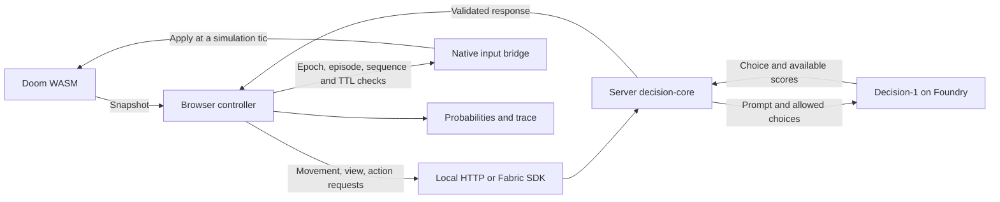

# DOOM: Decision-1 on Foundry

Microsoft Decision-1 controls a full Doom level running in your browser. Watch the game, model option probabilities, observations, executed actions and latency in one view.

The application combines a custom Doom WASM engine, Freedoom E1M1 and Microsoft-Decision-1 inference, with independent movement, view and action channels. It includes a local Node API and Microsoft Fabric integration. Browser compatibility and inference test results are documented in [verification results](docs/verification.md).

## Quickstart

Requirements: Node.js **24**, npm, a modern browser, internet access and a Microsoft-Decision-1 deployment in Microsoft Foundry. The engine and Freedoom Phase 1 are included.

```sh
npm ci
```

Create `.env.local` from `.env.example`:

```powershell
# Windows PowerShell
Copy-Item .env.example .env.local
```

```sh
# macOS / Linux
cp .env.example .env.local
```

Set the server configuration:

```dotenv
FOUNDRY_RESOURCE_ENDPOINT=https://YOUR-RESOURCE.services.ai.azure.com
FOUNDRY_DEPLOYMENT=Decision-1
FOUNDRY_AUTH=entra
```

Set `FOUNDRY_DEPLOYMENT` to the deployment name configured in Foundry. Set `FOUNDRY_RESOURCE_ENDPOINT` to the resource origin or the full `/providers/microsoft/v1/systemone` endpoint URL.

Sign in with `az login` using an identity with inference access, then:

```sh
npm run dev
```

Open **http://127.0.0.1:5173**, click **Launch E1M1**, then **Start AI**. The command starts Vite and a loopback Node API together. Ctrl+C stops both. Model inference runs in Foundry.

If PowerShell blocks `npm.ps1`, use `npm.cmd` for the commands in this README.

For API-key authentication set `FOUNDRY_AUTH=key` and `FOUNDRY_API_KEY` in `.env.local`. Store credentials in server-side environment variables. Restart the server after configuration changes. Entra access tokens are cached in server memory and refreshed before expiry. Token handling stays on the server.

Production-style local run:

```sh
npm run build
npm start
```

Open **http://127.0.0.1:8787**. This serves frontend and API from one local origin.

## Deploy Microsoft-Decision-1 in Foundry

You can use an existing deployment or create your own. The [official Microsoft guide](https://learn.microsoft.com/en-us/azure/foundry/foundry-models/how-to/use-foundry-models-microsoft-decision) documents the Decision API and supported deployment types.

| Step | Action |
| --- | --- |
| Resource | Select an Azure subscription and create a Microsoft Foundry resource and project in the [Foundry portal](https://ai.azure.com/). |
| Model | Open the model catalog, search for **Microsoft-Decision-1**, and choose **Deploy**. |
| Capacity | Select a deployment type and capacity supported by your subscription and resource region. Check availability and quota for the selected region. |
| Configuration | Name the deployment, for example `Decision-1`. Copy its resource endpoint and deployment name into `.env.local`. |
| Permissions | Grant the calling identity inference access, such as **Cognitive Services User**. Deployment management requires separate permission, such as **Cognitive Services Contributor**. Sign in to the intended tenant/subscription with Azure CLI and allow time for role propagation. |
| Connection test | Run `npm run smoke:foundry`. It makes one real, billable call, reports latency and writes a redacted response to ignored `artifacts/foundry-smoke.json`. |

If the Foundry resource already exists, an equivalent deployment command is:

```sh
az cognitiveservices account deployment create --resource-group YOUR_RESOURCE_GROUP --name YOUR_FOUNDRY_RESOURCE --deployment-name Decision-1 --model-name Microsoft-Decision-1 --model-format Microsoft --model-version 1 --sku-name GlobalStandard --sku-capacity 1
```

This command works on PowerShell and POSIX shells. Replace the placeholders and choose a SKU/capacity supported by your subscription. The application sends decision requests to `POST /providers/microsoft/v1/systemone`.

## Playing and inspecting decisions

The application includes the complete **Freedoom Phase 1 0.13.0 E1M1** level. To use the original level, select your own `DOOM1.WAD` before launch. The WAD is loaded into browser memory. Reload to change the IWAD. Difficulty defaults to **Hurt Me Plenty**.

* **Start AI / Stop AI:** inference controls versus released input. Stop AI leaves the visible game running.
* **Manual:** exclusive diagnostic control. WASD moves, left/right arrows turn, Ctrl fires, Space uses doors/switches. AI is stopped first.
* **Restart:** starts a fresh E1M1 episode and invalidates pending decisions. It does not automatically resume AI.
* **Hidden tab:** suspends simulation and releases all controls. Resume explicitly. Simulation resumes from the paused state.
* **Audio:** sound effects. MIDI music is not bundled.
* **Trace:** click a row for its original observation, request/response and execution result. Export JSON or JSONL. Each record links a model decision to its source observation and executed input.

Observations come from engine sensors. They include visible enemies/items, nearby traversability, inventory, recent effects and visit memory. The model selects all movement, targets and actions. A deterministic executor turns toward the heading selected from the observation snapshot. Option probabilities describe the model’s distribution over the available choices.

## How it works

The browser loads the IWAD into the WASM filesystem and starts E1M1. After each simulation tic the engine captures player state, visible objects, nearby geometry and active input channels. The controller adds bounded exploration memory and sends a fresh observation through the selected transport. Doom keeps running while inference is in flight.



The server creates the model prompt and legal choices for the requested channel. Decision-1 returns one selected option through `answers[channel].choice`. The response carries correlation IDs, scores when supplied, server timing and available model metadata. The browser validates the result and the native bridge checks it again at execution. A movement response changes only movement, a view response changes only heading and an action response changes firing or interaction.

| Module | Responsibility |
| --- | --- |
| [engine/bridge.c](engine/bridge.c) | Native input leases, collision feedback, snapshots and execution acknowledgements |
| [engine/browser.c](engine/browser.c) and [engine/render.c](engine/render.c) | Simulation timing, rendering, camera interpolation and performance counters |
| [engine/interactions.c](engine/interactions.c) | Observed surfaces, use-ray checks, door state and actual activation feedback |
| [src/game/bridge.ts](src/game/bridge.ts) | WASM loading, IWAD validation, copied observations and native calls |
| [src/agent/controller.ts](src/agent/controller.ts) | Three request lanes, freshness checks, cancellation, waits and bounded traces |
| [src/agent/memory.ts](src/agent/memory.ts) | Visited cells, observed passages, movement effects and last-seen enemy memory |
| [decision-core](decision-core) | Shared prompt construction, response validation and redacted diagnostics |
| [shared/contracts.ts](shared/contracts.ts) | Zod schemas, option catalog, channel headings and session defaults |
| [server](server) and [rayfin/functions](rayfin/functions) | Local API and Fabric wrapper around the same decision core |
| [src/transports](src/transports) | Local HTTP and Fabric SDK implementations of the same transport interface |
| [src/ui](src/ui) | Orange theme, gameplay controls, channel probabilities and trace inspection |

## Technical notes

### Inputs, rendering and observations

The model can choose fine aim (3.5 degrees), normal turns (14 degrees), large scanning turns (45 degrees), or a visible enemy/surface's recorded world point. Scanning uses an absolute heading derived from the source observation. A direction already reached or passed is not replayed. A selected point stays fixed for its lease while the executor compensates the player's own translation each tic. Feedforward uses observed player travel. Moving enemies need another model decision. Rotation is limited to 90 degrees/s and 720 degrees/s², with a 0.5-degree stationary alignment tolerance. `continue_turn` preserves the existing point or scan goal.

**Three independent HTTP loops** request movement, view and action separately, each using a fresh snapshot. Each channel permits one outstanding request and at most two starts/s, with six starts/s and three outstanding requests in total. Updating view does not cancel movement or fire. Movement/fire leases expire after 650 ms, view after 750 ms. Use/equipment are short pulses. A timeout or invalid response releases only its own channel. Engine diagnostics use a separate combined-action catalog.

Simulation stays at 35 tics/s. Rendering runs independently at up to 60 FPS and interpolates only the camera between completed tics. Sensors and hit tests always use actual simulation state. The panel shows FPS, TPS and render time. Exports include p95 frame intervals, render costs and per-channel lease expiry/idle measurements. Input-gap measurements are sampled at simulation tics and reset on level restart.

Exploration memory reports failed movement in the requested direction, recently observed headings at the current location, time without travel, turning without progress and up to four recently seen enemies' last-known bearings. The prompt uses these observations when requesting the next movement or turn. Enemy memory expires after five seconds; retained entries are marked as last-seen observations.

The current combat prompt favors strafing or retreating while firing with a loaded ranged weapon, and searching after blocked movement or unseen damage. AI forward input is 14, strafe input is 12 and retreat input is 25. Manual walking uses the engine’s standard movement speed. Sensors report clearance for the player's box as well as the center ray. Three consecutive failed displacement tics after acceleration release only the blocked movement and display **blocked by collision**. The next model decision selects the maneuver using updated collision feedback. Calibration can be run explicitly with `npm run evaluate:navigation` (real, billable Foundry calls).

The decision sidebar keeps the latest available probabilities visible while another request is in flight. Separate groups show **Movement**, **Look & search**, and **Action**. Rows stay in a fixed order. Bars animate to new values, and each group's source observation tic remains visible. Missing scores retain that channel's last scored sample. Three input badges show the independent choices. An Updating indicator marks requests in flight.

The interaction panel shows visible doors/switches, their state and whether the current use ray reaches them. Observations distinguish closed, opening, passable and closing doors. Colored lock requirements are classified from usable linedefs only after front-side, FOV and line-of-sight filtering, before the first use attempt. **Use** is offered only for a ready or closed surface within the use ray, with activation available and no known missing key. Execution revalidates the surface state and use conditions. Accepted use invalidates requests from before activation and obtains fresh observations. An aligned point lease permits use when the camera is stationary.

The prompt lists blue, yellow and red key cards and skull keys in the inventory. A card or skull of the matching color satisfies a lock. Visible key sprites are identified by color and kind, and `face_key_ID` offers their recorded direction. For a locked door with a missing key, the prompt directs the model to inspect accessible passages and collect the matching key by walking over it. Translation should hold while an off-axis needed key is being aligned. Bounded memory retains up to 16 observed locks and 12 last-seen key locations across turns, with bearings updated only from the player's own position. Acquiring that color updates remembered locks and removes obsolete key clues. Memory contains observed locks and key locations and resets for each episode or map. `npm run evaluate:keys` tests these conditions against real Foundry inference.

Decision-1 can choose **wait** to release all controls for up to 600 ms while the world continues. During that wait the controller checks the same observed door every 35 ms and wakes request lanes as soon as it is passable. The next eligible request is reserved for movement, within its 2/s limit. The model chooses the next move from fresh observations. A wait that became unnecessary during HTTP is rejected without cancelling a pending movement decision. Unrelated doors do not end the wait, and switches retain the bounded timer. The prompt favors passage once the opening provides enough clearance.

Default controller settings are six requests/s maximum, one outstanding request per channel, 500 ms observation TTL, 1200 ms timeout and a 15-minute AI session limit. TTL starts at native snapshot capture. TTL and client timeout can be adjusted before starting AI. The independent server deadline is `DECISION_TIMEOUT_MS`. Exported logs record those settings. Correlation, channel sequence, epoch, episode, selected heading/point and TTL are checked before execution and again at the native tic boundary. Accepted waits require stationary movement/view, invalidate outstanding decisions and pause all three loops for at most 600 ms. Use additionally requires the current use ray to reach an available surface.

### Parameters and session data

| Parameter | Default |
| --- | --- |
| Observation schema | `4` |
| Prompt and catalog | `tactics-9` |
| Native bridge | `bridge-9` |
| Simulation / rendering targets | 35 TPS / up to 60 FPS |
| Request rate | Up to 2 starts/s per channel, 6 starts/s total |
| Concurrent requests | One per channel, three total |
| Observation TTL / request timeout | 500 ms / 1200 ms |
| Movement and firing lease / view lease | 650 ms / 750 ms |
| Wait / passability polling / session limit | Up to 600 ms / 35 ms / 15 minutes |
| AI forward / strafe / retreat input | 14 / 12 / 25 |
| Visible objects / visible surfaces | Up to 12 / up to 8 |
| Recent movement history / retained trace | 6 effects / 1,000 records |
| Enemy memory expiry | 175 simulation tics |

An observation ID identifies an episode and completed tic. Reading the same native snapshot twice does not create a newer timestamp. Movement reports signed progress, blocked tics and its actual termination reason. View reports its selected snapshot heading or point, the direction required from the current player position and measured angular error. Rejected decisions include a rejection reason in the trace.

JSON export contains session metadata and the bounded trace array. JSONL starts with a metadata record followed by one record per decision. Metadata includes prompt, catalog and engine versions, the IWAD SHA-256, session parameters, transport, final outcome and performance measurements. Opening a trace row shows the source observation, response and execution record. Exported probabilities describe the model’s distribution over available choices.

Credentials and endpoint configuration remain on the server. The local API uses `DefaultAzureCredential` by default, supports explicitly selected API-key authentication and caches Entra tokens until shortly before expiry. The browser sends typed observations; the server constructs the model prompt. Local and Fabric handlers share the same decision validation and inference code. Detailed boundaries are documented in [architecture](docs/architecture.md).

### Interface

The interface uses orange accents on dark warm surfaces. Layout, responsive rules and theme variables (`--accent`, `--surface`, `--line` and `--dim`) are defined in [style.css](src/ui/style.css). Channel proposals, native input badges, sample age and latency use separate fields. Probability bars retain their last scored sample and animate with scale transforms.

## Commands and checks

| Command | Purpose |
| --- | --- |
| `npm run dev` | Start Vite and the local Node API |
| `npm run build` / `npm start` | Build and serve the local application |
| `npm run clean` | Remove generated builds, temporary cache and browser test output |
| `npm test` | Contract, parser and scheduler tests without paid inference |
| `npm run smoke` | Full-map browser tests. Install browsers with `npx playwright install chromium firefox` first |
| `npm run smoke:foundry` | One real Foundry connectivity request |
| `npm run smoke:live` | One minute of actual model-controlled play against a running local app |
| `npm run smoke:interactions` | Paid door interaction diagnostic against `npm run dev`: real model choices, full map with a test spawn |
| `npm run smoke:keys` | Paid blue-lock diagnostic with a key behind the test spawn, verifying model retreat, pickup, use and passage |
| `npm run evaluate:decisions` | Three real calls per synthetic tactical situation. No game input |
| `npm run evaluate:interactions` | Three real calls per synthetic door/switch/wait/key situation |
| `npm run evaluate:combat` | Three real calls per synthetic evasive-combat situation |
| `npm run evaluate:search` | Three real calls per synthetic wall/search situation |
| `npm run evaluate:navigation` | Three real calls per wall-footprint, ranged-combat and unfinished-search-turn situation |
| `npm run evaluate:keys` | Three real calls per missing-color, visible/remembered key, alignment and matching-skull situation |
| `npm run build:engine` | Recompile using the pinned SDK. See [engine build](docs/engine-build.md) |
| `npm run package:engine-source` | Refresh the corresponding source archive after engine changes |
| `npm run verify:assets` | Verify committed binary/data hashes |
| `npm run build:fabric` | Build isolated `dist-fabric` and Functions artifacts |
| `npm run verify:packages` | Create inspection ZIPs and check Fabric size limits |
| `npm run dev:fabric` | Vite connected to a configured remote Fabric backend |
| `npm run deploy:fabric` | Deploy to the selected Fabric workspace |

For live smoke, `APP_URL`, `LIVE_DURATION_MS` and `LIVE_TTL_MS` customize the target, duration and freshness. `LIVE_RUN_ID` names the output files to preserve earlier runs. For example, `npm run smoke:live -- --duration-ms=30000 --run-id=my-run`. The report includes per-channel latency, native performance, completed heading errors, blocked observations and executed inputs. `node scripts/compare-live.mjs BEFORE.json AFTER.json comparison.json` compares recorded exports without making model calls. The script writes local traces and screenshots, and fails if no inputs were applied. Evaluations use synthetic observations with real inference and save versioned results. CI runs fixture-based tests and browser diagnostics.

The interaction diagnostic preserves full Freedoom E1M1 geometry but changes the player spawn to face a door and disables other spawned things to isolate the mechanism. The model chooses all inputs. The test records use, wait and passage execution, then stops after the player crosses the doorway. Diagnostic fixtures are not part of the application bundle.

`npm run clean -- --dry-run` lists the generated paths selected for cleanup. Stop build and test processes before cleaning. The command removes `dist`, `dist-server`, `dist-fabric`, `rayfin/functions/dist`, `engine/build`, `.cache`, `test-results`, `playwright-report` and the two package inspection ZIPs in `artifacts/`. Recorded measurements in `artifacts/` are local verification evidence and are excluded from Git. Prebuilt WASM, its corresponding source archive, Freedoom data and licenses in `public/` are required application assets.

## Fabric and implementation details

Follow [Fabric deployment](docs/fabric.md) for identity, secrets, SDK transport, package checks and remote acceptance. Local and Fabric builds use the same decision contract and prompt. Each browser tab runs an independent game session.

See [architecture](docs/architecture.md), [engine rebuild](docs/engine-build.md) and [verification](docs/verification.md). Engine source, artifact hashes and dependency lockfiles are included. Asset provenance and licensing are documented in [third-party notices](THIRD_PARTY_NOTICES.md) and [LICENSE](LICENSE).

## Troubleshooting

* **Foundry not configured:** edit `.env.local` and restart Node. Health checks do not make model calls.
* **401/403:** check login, tenant, inference role and resource permissions. For Fabric, check the deployed function’s identity and inference permissions.
* **404/422:** verify the resource endpoint and exact deployment name.
* **429:** the controller respects Retry-After and obtains a fresh observation after backoff. Check quota and other callers.
* **Expired observations:** inspect each channel's p50/p95 and rejected traces before adjusting TTL. Compare startup and steady-state latency. The controller permits up to six requests/s across three channels; completed throughput depends on inference latency and service limits.
* **No sound:** launch with a click and enable audio. This build provides sound effects only.
* **Fabric errors:** check the deployed function’s identity, secrets and SDK transport configuration, then run the remote smoke test described in [Fabric deployment](docs/fabric.md).
