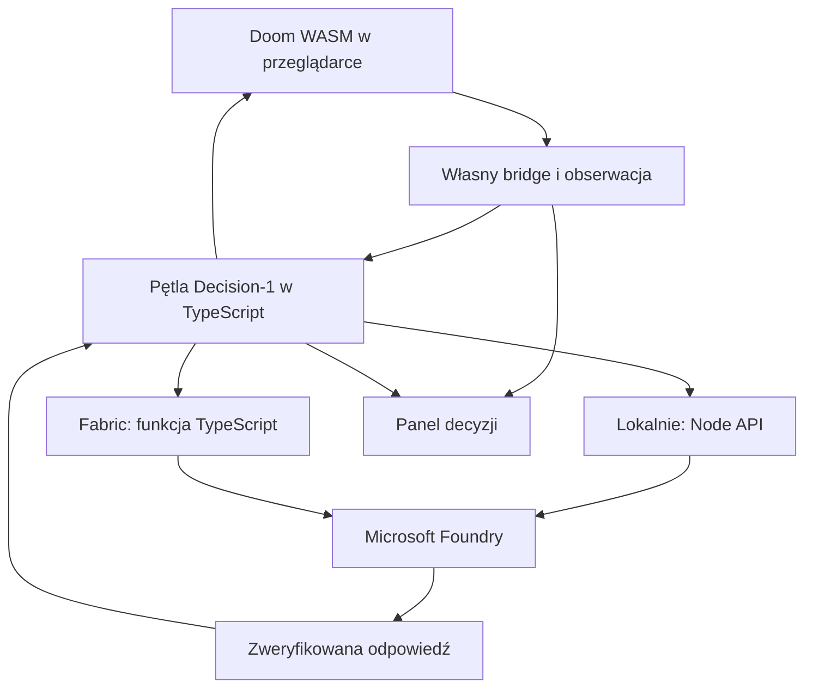

# DOOM: Decision-1 on Foundry — plan dla Codexa

Wersja 3, 18.10.2026. Obowiązująca specyfikacja po zmianie wymagań użytkownika. Zastępuje wcześniejsze warianty z ViZDoom na backendzie, kontenerami, arenami i porównaniem kontrolerów.

To plan implementacji, nie raport z uruchomionej aplikacji. Sprawdzono repozytoria i dokumentację. Nie wykonano wdrożenia, wywołania modelu w subskrypcji użytkownika ani pomiarów działania nowego systemu.

## 1. Cel i obowiązujący zakres

Zbudować aplikację, w której **Microsoft-Decision-1 w Microsoft Foundry gra na pełnym poziomie Dooma**, a użytkownik ogląda grę i podejmowane decyzje na żywo.

Wymagania użytkownika:

- Uruchomienie lokalne bez Dockera i kontenerów.
- Możliwość opublikowania aplikacji w Fabric Apps.
- Pełny poziom od pierwszej działającej wersji, bez etapu aren treningowych.
- Bez prostego bota, losowego kontrolera, trybu baseline i porównań z nimi.
- Projekt Jev służy wyłącznie jako przykład; niezależny kod, prompty i UI.

**Wybór architektury:** Doom w WebAssembly w przeglądarce, frontend TypeScript/React, mały lokalny backend Node.js do Foundry. Na Fabric ten backend zastępuje cienka funkcja TypeScript. Logika requestu i walidacji jest współdzielona.

„Lokalnie” dotyczy aplikacji i gry. Model nadal działa w Foundry, więc potrzebne są internet, deployment oraz dostęp do inference. Nie planujemy uruchamiania wag Decision-1 na komputerze użytkownika.

## 2. Nazwa i opis repo

**Nazwa:** `doom-decision-1-foundry`

**Tytuł:** `DOOM: Decision-1 on Foundry`

**GitHub description:**

> Microsoft Decision-1 plays full Doom levels in your browser, with live action scores and decision traces. Run locally without Docker or deploy to Fabric Apps.

Opis przedstawia docelowy projekt. Dopóki test Fabric nie przejdzie, README ma oznaczać ten tryb jako nieweryfikowany, a nie gotowy.

## 3. Co ustalono i co pozostaje do sprawdzenia

| Element | Ustalenie | Status |
| --- | --- | --- |
| Repo użytkownika | `doom-fabric-apps` już uruchamia browserowy Doom i ma konfigurację statycznego hostowania Fabric | Kod sprawdzony [S0] |
| Dostęp do stanu | Obecny loader nie ma API obserwacji ani sterowania agentem | Potrzebny własny bridge |
| Upstream silnika | `ozkl/doomgeneric` ma target Emscripten i port browserowy | Kod sprawdzony [S1] |
| Decision-1 | Udokumentowane wejście tekst/JSON i decyzje liczbowe bez pisemnego uzasadnienia | Dokumentacja [S3] |
| Fabric Apps | Statyczny frontend oraz serwerowe funkcje TypeScript | Dokumentacja [S4, S5] |
| Foundry z Fabric | Dokumentowane połączenie `AzureAI` i token w kontekście funkcji | Mechanizm dostępny; konkretny Decision endpoint wymaga smoke testu [S6] |
| Pełny poziom | Silnik uruchomi mapę; skuteczność modelu w eksploracji i ukończeniu jest nieznana | Do sprawdzenia w aplikacji |
| Latency | Nie ma pomiaru Node → Foundry ani Fabric Function → Foundry | Zmierzyć obie ścieżki |

Repo użytkownika sprawdzono na commicie `63e5f67dd132498ee87a505f373d2e5e92c91460`. Upstream doomgeneric sprawdzono na `e257a09527062bfb986b6e5e0780839b6cbd5b71`, w szczególności `doomgeneric/Makefile.emscripten` i `doomgeneric/doomgeneric_emscripten.c`.

W istniejącym repo `server.js` jest serwerem statycznym do lokalnego uruchomienia. `public/app.js` ładuje binaria Emscripten. To dobry punkt wyjścia dla powłoki aplikacji, ale wymaga przebudowania silnika z własnymi eksportami. Nie próbować odczytywać zdrowia czy przeciwników z nieudokumentowanych offsetów pamięci gotowego WASM.

## 4. Architektura i dwa sposoby uruchomienia



| Część | Lokalnie | Fabric Apps |
| --- | --- | --- |
| Silnik, obraz, audio | Browser + WASM | Ten sam browser + WASM |
| Frontend | Vite | Statyczny build w Fabric |
| Wywołanie Decision-1 | Node API na loopback | Fabric Function |
| Uwierzytelnienie Foundry | Konfiguracja serwera / lokalne Azure credentials | Token platformowy lub sekret funkcji |
| Historia decyzji | Pamięć + eksport pliku | Pamięć + eksport pliku |

Nie przesyłać obrazu gry przez backend. Canvas i telemetria są w tej samej przeglądarce. W MVP nie potrzeba WebSocket, WebRTC, serwera video, Pythona, ViZDoom, Container Apps ani bazy danych.

Każda karta uruchamia własną rozgrywkę. Udostępnienie App URL nie oznacza oglądania tej samej sesji przez wszystkich. Wspólny stream dla publiczności nie jest częścią tej wersji; do prezentacji można udostępnić ekran.

## 5. Uruchomienie bez Dockera

Docelowy quickstart po dostarczeniu gotowych artefaktów silnika:

```bash
npm ci
npm run dev
```

Przed pierwszym użyciem skonfigurować serwerowy `.env.local` według `.env.example`. Skrypt startuje frontend i mały Node API jednym poleceniem, z poprawnym zamykaniem obu procesów. Nie używać unixowego `&` jako jedynej implementacji; quickstart musi działać również na Windows.

Zaprojektowane komendy projektu:

| Komenda | Cel |
| --- | --- |
| `npm run dev` | Vite + lokalny Node API; bez Fabric login i bez lokalnego backendu Rayfin |
| `npm run build` | Frontend i Node API z gotowym WASM |
| `npm start` | Zbudowany frontend i API pod jednym lokalnym origin |
| `npm run build:engine` | Przebudowanie własnego WASM z przypiętego upstreamu |
| `npm run dev:fabric` | Frontend połączony ze skonfigurowanym backendem Fabric |
| `npm run deploy:fabric` | Pełne wdrożenie przez Rayfin |
| `npm test` | Testy kontraktów, bridge i obsługi odpowiedzi |
| `npm run smoke` | Test pełnego poziomu w przeglądarce |

To komendy do zaimplementowania, nie istniejące już możliwości repo.

Wymagania użytkownika uruchamiającego gotową wersję: Node.js/npm, przeglądarka, konfiguracja Foundry oraz dostępne dane gry. Emscripten i narzędzia kompilacji są potrzebne autorowi bridge lub CI, nie każdemu uruchamiającemu demo. SDK Emscripten da się zainstalować natywnie, również na Windows lub w WSL, bez Dockera. [S2]

Pierwszy build silnika wykonać podczas implementacji. Dostarczyć z niego artefakty w repo albo przypiętym wydaniu z kontrolą hashy. Nie wymagać automatycznego kompilowania C przy każdym `npm ci`. Dołączyć odpowiadający im kod, patche, wersję SDK i przepis odtworzenia buildu.

Domyślne `npm run dev` nie może być aliasem do standardowego `rayfin dev`: ścieżka Rayfin może uruchamiać dodatkowe usługi. Nasz lokalny profil korzysta wyłącznie z Vite i Node. Tryb testowania Fabric jest oddzielny.

## 6. Silnik i własny bridge

Kontynuować rodzinę silnika z repo użytkownika: oficjalny `ozkl/doomgeneric`, własne zmiany, własny build. Nie używać silnika, bridge ani binariów z repo Jev.

Przygotować projektowe API C → WASM → TypeScript, przykładowo:

- `readObservation()` — snapshot stanu po zakończonym ticu;
- `applyAction(actionId, durationTics, epoch)` — ustawienie wejścia z terminem ważności;
- `releaseControls()` — natychmiastowe wyzerowanie wejścia agenta;
- `startLevel(iwad, map, skill)` — start wybranej mapy;
- `restartLevel()` — nowa generacja sesji;
- `readGameEvents()` — obrażenia, pickup, śmierć, koniec poziomu, zmiana mapy.

Nazwy są własnym kontraktem do implementacji, nie obecnym API upstreamu. Bridge nie teleportuje postaci, nie zmienia HP/ammo, nie zabija przeciwników i nie otwiera drzwi przez zmianę stanu świata. Wejście agenta trafia do normalnej ścieżki sterowania grą.

Snapshot musi być spójny, ograniczony rozmiarem i posiadać `schemaVersion`, `episodeId`, `mapId`, `gameTic`. Zweryfikować jednostki fixed-point, orientację osi i normalizację kątów. Bufor przeznaczony dla JS musi mieć określony czas życia; nie zwracać wskaźnika do zmiennej lokalnej ani przepełnianego bufora JSON.

Własne sterowanie podłączyć do tick/input path. Nie opierać całego agenta na syntetycznych `KeyboardEvent`, które mogą nie działać jak fizyczna klawiatura w SDL/Emscripten.

W repo upstream target Emscripten istnieje, ale stary Makefile nie jest dowodem zgodności z najnowszym emsdk. Przypiąć działające wersje, skorygować build/audio/SDL według aktualnej dokumentacji, a wynik potwierdzić w przeglądarce. Nie kopiować komend kompilacji z Jev.

Preferować single-thread WASM, bez wymagania `SharedArrayBuffer`, pthreads i specjalnych nagłówków COOP/COEP. To zmniejsza zależność od konfiguracji statycznego hostingu. Nie blokować głównej pętli oczekiwaniem na HTTP. Jeśli worker stanie się potrzebny, sprawdzić obsługę canvas/audio zamiast zakładać, że przeniesienie silnika jest bezkosztowe.

## 7. Pełny poziom od początku

Główny scenariusz to **E1M1 z lokalnego DOOM1.WAD użytkownika**. Publiczny wariant bez oryginalnych zasobów może używać pełnej mapy E1M1 z Freedoom Phase 1. To inne poziomy; zapisać tytuł, wersję, hash IWAD i nazwę mapy. Nie przedstawiać Freedoom jako oryginalnej mapy Dooma.

Oryginalny WAD można wybrać w przeglądarce i załadować do wirtualnego filesystemu przed startem. Nie wysyłać go do Foundry ani backendu. Build silnika powinien umożliwiać wymianę IWAD, zamiast wiązać aplikację z jednym zasobem zaszytym w `.data`.

Pierwsza działająca wersja ma pełną geometrię i mechanikę poziomu: przeciwników, przedmioty, drzwi, przełączniki i wyjście. Nie wstawiać do harmonogramu `basic`, `defend_the_center` lub własnego pokoju testowego jako produktu pośredniego. Techniczne testy bridge można wykonywać na zarejestrowanych stanach tej samej pełnej mapy.

Start po kliknięciu użytkownika: odblokowanie audio, inicjalizacja silnika i przejście bezpośrednio do wybranego poziomu. Trudność jest jawna; wartość początkowa to standardowa trudność gry, konfigurowalna przed startem. Brak god mode i ukrytych ułatwień.

**Pełny poziom w aplikacji nie oznacza gwarancji jego ukończenia przez model.** Celem sterowania jest dotarcie do wyjścia. Śmierć, utknięcie i timeout są prawdziwymi wynikami, pokazywanymi w UI. Nie zaliczać zakończenia od timera jako ukończenia mapy.

## 8. Stan gry dla Decision-1 i pamięć eksploracji

Decision-1 otrzymuje niewielki, ustrukturyzowany opis sytuacji. MVP wykorzystuje dane silnika, a nie model vision. Na ekranie umieścić `Engine-assisted observations`.

| Grupa | Zakres |
| --- | --- |
| Gracz | HP, armor, ammo, weapon, posiadane klucze, pozycja i orientacja |
| Przeciwnicy | Widoczni, typ/kategoria, względny kierunek i odległość |
| Przedmioty | Dostrzegalne, rodzaj i położenie względem gracza |
| Przestrzeń | Krótkie pomiary przeszkód i przejść wokół postaci |
| Interakcje | Zaobserwowane drzwi/przełączniki, dystans i rezultat ostatniej próby użycia |
| Historia | Ostatnie akcje i obserwowane skutki, utrata HP, zmiana ammo, brak postępu |
| Pamięć | Odwiedzone miejsca, znane przejścia, niedawno nieudane próby |
| Cel | Przeżyj, eksploruj i znajdź wyjście z poziomu |

Widoczność musi mieć zdefiniowaną semantykę. Line-of-sight do środka obiektu i kąt widzenia to przybliżenie, nie dowód widoczności sprite'a na ekranie. UI i dokumentacja powinny mówić o sensorach silnika; za pomocą testów sprawdzić obiekty za ścianą i poza FOV. Nie używać pełnej listy obiektów jako rzekomo widocznych.

Nie ujawniać automatycznie HP przeciwnika, wszystkich sekretów, mapy całego poziomu i pozycji nieodkrytego wyjścia. Brak danych to `unknown`, nie wymyślona wartość. Wiedza o kluczach bierze się z ekwipunku, a wymaganie danego klucza z zaobserwowanej informacji gry; nie zgadywać go z koloru przypadkowej tekstury.

Pamięć odwiedzin buduje adapter z trajektorii i obserwowanych przejść. Nie zawiera z góry zakodowanej trasy po E1M1. Wynik wykrycia utknięcia opisuje brak przemieszczenia po próbach ruchu, ale sam nie wybiera manewru ratunkowego. Model dostaje ten sygnał i decyduje o kolejnym ruchu.

Zacząć od maks. 12 obiektów, 6 ostatnich akcji i krótkiego podsumowania odwiedzin. Limit całego requestu ustalić po pomiarze tokenów. Kolejność obiektów ma deterministyczną, opisaną regułę; obcięcie jest jawne. Cechy wejściowe i prompty wersjonować.

## 9. Katalog działań

Model wybiera `actionId` z własnej, stałej biblioteki krótkich działań. Początkowy zestaw:

| Akcja | Realizacja |
| --- | --- |
| `advance`, `retreat` | Krótki ruch do przodu/do tyłu |
| `strafe_left`, `strafe_right` | Krótki ruch boczny |
| `turn_left`, `turn_right` | Krótki obrót |
| `fire` | Krótka seria z aktualnej broni |
| `advance_fire` | Ruch do przodu i strzelanie |
| `strafe_left_fire`, `strafe_right_fire` | Ruch boczny i strzelanie |
| `use` | Zwykła próba użycia przed postacią |
| `equip_<weapon>` | Zmiana na konkretną posiadaną broń |
| `release` | Zwolnienie wejścia |

Czasy akcji są parametrami katalogu, początkowo ok. 2–10 ticów zależnie od ruchu. Kalibracja odbywa się na pełnym poziomie. Executor nie dobiera celu, nie wyznacza ścieżki i nie naprowadza automatycznie celownika. Standardowe mechaniki silnika, w tym jego aim assist, pozostają opisane w konfiguracji.

Akcje można łączyć w jeden jawny wektor przycisków; brak konieczności osobnych requestów dla ruchu i strzału. Nie kopiować podziału osi, nazw ani katalogu taktycznego z Jev. Opcje dla nieposiadanej broni nie pojawiają się w requestach.

Model decyduje o eksploracji, użyciu drzwi, walce, odwrocie i zmianie broni na podstawie kolejnych obserwacji. W razie słabego działania poprawiać reprezentację i długość ruchów, bez cichego dodawania autopilota. Nie potrzebujemy osobnego modelu planującego w MVP.

## 10. Adapter Foundry i warstwa serwerowa

Wspólny moduł serwerowy `decision-core` zawiera walidację obserwacji, budowanie requestu, wywołanie API, parser odpowiedzi i redakcję danych. Dwa cienkie wrappery: Node HTTP lokalnie oraz Fabric Function po publikacji.

Endpoint modelu:

```text
POST {FOUNDRY_RESOURCE_ENDPOINT}/providers/microsoft/v1/systemone
```

Request zawiera nazwę deploymentu w `model`, stan w `state` i pytanie `choice` z opcjami. Nie stosować Chat Completions jako zamiennika. Nazwę deploymentu, dostępność regionu/SKU i uprawnienia potwierdzić w rzeczywistym środowisku. [S3]

Dokładne pole z wynikami opcji oraz usage należy zweryfikować na prawdziwej odpowiedzi Foundry. Nie przenosić schematu odpowiedzi Jev i nie generować sztucznych score, gdy API ich nie zwróciło.

Lokalne API:

- `GET /api/health` — gotowość serwera, bez wywołania modelu;
- `POST /api/decision` — jedna obserwacja i jedna odpowiedź modelu;
- opcjonalny endpoint konfiguracji publicznej, bez sekretów.

Node nasłuchuje domyślnie na loopback. Vite proxy kieruje `/api` do Node, a `npm start` podaje statyczny frontend i API razem. `.env.local` czyta proces backendu; sekret nie ma prefiksu `VITE_`. Użycie `DefaultAzureCredential` lub API key jest konfigurowalne po stronie serwera.

Frontend implementuje `DecisionTransport`: wersja lokalna używa HTTP, a wersja Fabric wywołuje zarejestrowaną funkcję przez SDK. Wybór transportu jest jawny. Nie zmienia kontraktu obserwacji, katalogu akcji ani logiki gry.

Backend ustala dozwolony endpoint, deployment, katalog akcji i prompt. Nie przyjmuje arbitralnego URL-a, sekretu czy pełnego promptu od przeglądarki. Ogranicza payload, czas wykonania i dostęp do funkcji. Normalizowana odpowiedź zawiera `requestId`, `choice`, `optionScores`, wersję modelu i pomiary serwera; nazwy te są własnym kontraktem aplikacji.

## 11. Pętla live i aktualność decyzji

Gra działa w swoim rytmie; HTTP nie może zatrzymywać ticów. Startowy limit zapytań: 3/s, maks. jeden aktywny request na sesję. Mierzyć rzeczywistą częstotliwość, nie podpisywać skonfigurowanego limitu jako wyniku.

Przebieg:

1. Pobierz spójny snapshot z tic i lokalnym czasem monotonicznym.
2. Nadaj `episodeId`, `controllerEpoch`, `requestId`, `observationId`.
3. Wywołaj transport asynchronicznie; silnik kontynuuje grę.
4. Po odpowiedzi sprawdź format, katalog opcji, epizod i wiek obserwacji.
5. Zastosuj zaakceptowaną akcję w najbliższej bezpiecznej granicy tica.
6. Zapisz potwierdzony `appliedTic` i automatycznie wygaś wejście po czasie akcji.
7. Kolejna decyzja zawsze korzysta z nowego snapshotu.

Wartości startowe do pomiaru: ważność obserwacji 500 ms, timeout całej ścieżki 1200 ms, maksymalny czas przytrzymania 300 ms. Parametry można zmienić na podstawie prawdziwego czasu Node/Fabric → Foundry. Nie obiecywać, że Fabric Function zmieści się w budżecie bez sprawdzenia cold start i narzutu wywołań.

Śmierć, restart, zmiana mapy, zatrzymanie AI i przejęcie ręczne zwiększają epoch. Odpowiedź z wcześniejszej generacji jest rejestrowana jako odrzucona, nie stosowana. Timeout zwalnia przyciski — nie uruchamia bota.

Wygaszenie wejścia realizować również w kodzie silnika przed użyciem polecenia. JS `setTimeout` nie może być jedynym zabezpieczeniem. Utrata widoczności karty zatrzymuje kontroler, zwalnia przyciski i pokazuje stan zawieszenia. Po powrocie odrzucić poprzednie odpowiedzi i pobrać nowy stan. Sprawdzić, że silnik nie nadrabia długiej przerwy z przeterminowanymi klawiszami.

Nie deklarować pracy live w tle przy browserowym throttlingu. Nie zamrażać tylko obrazu, zostawiając grę bez kontroli. Jeśli silnik wspiera prawdziwą pauzę, można ją obsłużyć jawnie; inaczej przycisk to `Stop AI`, a nie `Pause game`.

429/5xx: respektować Retry-After, ograniczony backoff, po nim nowa obserwacja. Po trwałym błędzie auth pokazać potrzebę poprawienia konfiguracji. Nie tworzyć kolejki zaległych requestów. Anulowanie HTTP po stronie klienta nie oznacza automatycznie przerwania inference ani anulowania kosztu; serwer także ma własny deadline.

## 12. Podgląd decyzji

Gra zajmuje większość ekranu. Obok niej czytelny panel aktualnej decyzji; na dole zwijana historia. Własny projekt wizualny, bez odtwarzania UI Jev. Teksty interfejsu i README po angielsku.

Panel:

- status silnika i Foundry, nazwa mapy, model/deployment;
- aktualna akcja oraz ostatnia propozycja modelu;
- wyniki dostępnych opcji, bez wymyślonej narracji;
- czas całego requestu i wiek obserwacji przy zastosowaniu;
- HP/ammo/weapon, wykryte obiekty i pamięć odwiedzin;
- oś zdarzeń: decyzja, wykonanie, odrzucenie, błąd, pickup, śmierć, wyjście;
- snapshot wejściowy i raw request/response po usunięciu sekretów.

Wynik opcji nie jest mierzoną szansą wygranej ani trafienia. Nie podpisywać panelu „chain of thought”. Opis tekstowy relacjonuje fakty, np. wybraną akcję i latency, a nie motywację niewyrażoną przez model.

Kontrolki: uruchom poziom, start/stop AI, restart poziomu, ręczne sterowanie do diagnostyki, fullscreen, dźwięk, eksport logu. Ręczne sterowanie jest jawne i wyklucza równoczesne akcje AI; nie jest baseline do porównania.

Zapis decyzji powiązać ze snapshotem z momentu obserwacji, nie z aktualnym obrazem. Przechowywać ograniczony bufor historii, z eksportem JSON/JSONL. Replay video jest opcjonalnym rozszerzeniem, nie warunkiem pierwszej wersji. Eksport obejmuje wersje promptów, schematów, bridge, WAD i parametry sesji.

## 13. Wdrożenie do Fabric Apps

Fabric hostuje statyczny frontend oraz krótką funkcję pośredniczącą do Foundry. Funkcja nie uruchamia silnika i nie przechowuje stanu gry. Dokumentacja opisuje funkcje TypeScript wywoływane przez Rayfin SDK. [S5]

Plan konfiguracji:

- `services.staticHosting.enabled: true`, folder z buildem frontendowym;
- `services.functions.enabled: true`;
- `services.functions.auth.type: application`;
- uwierzytelnienie Fabric dla użytkowników aplikacji;
- brak własnych modeli danych i storage w MVP, o ile zweryfikowany scaffold nie wymaga dodatkowych elementów platformy.

Zaktualizować CLI/SDK do przypiętej wersji wspierającej używane Functions; nie zakładać, że wersja ze starego repo wystarczy. Nie scaffoldować nad istniejącymi plikami bez kontroli diff. W nowym repo użyć nowych identyfikatorów wdrożenia.

Dla Foundry najpierw zweryfikować `AudienceType.AzureAI` i `ctx.Tokens.AzureAI`. Deployed app używa tożsamości aplikacji — według dokumentacji obecnie właściciela itemu — więc sukces na lokalnym koncie nie dowodzi dostępu po wdrożeniu. Nie nazywać tego managed identity. [S6]

Alternatywą jest API key przechowywany jako sekret i odczytywany przez `ctx.getSecret()`. W obu wariantach credential nigdy nie wraca do przeglądarki. [S7]

Statyczny build zawiera HTML/JS/CSS/WASM i dopuszczone zasoby. Functions package zawiera tylko mały kod serwera i jego zależności, bez WASM i WAD. Dokumentacja określa limit statycznego ZIP 100 MB i Functions ZIP 30 MB. [S4, S5]

Weryfikacja publikacji:

1. Załadowanie `.wasm`, `.data` i IWAD, z poprawnym MIME i ścieżkami względnymi.
2. Audio po kliknięciu i działanie canvasu w docelowej przeglądarce.
3. Zalogowany użytkownik potrafi wywołać funkcję; niezalogowany nie uzyskuje inference.
4. Prawdziwe wywołanie Decision-1 przez wdrożoną funkcję.
5. Co najmniej kilka minut gry na pełnej mapie, z pomiarem świeżych decyzji, błędów i opóźnień.
6. Ścieżki pod prefiksem URL działają tak jak w istniejącym repo użytkownika.

Początkowo prywatna aplikacja dla uprawnionych osób, limit sesji ok. 15 minut i ograniczenie liczby wywołań. Limit przeglądarkowy jest UX, nie zabezpieczeniem kosztowym: backend musi walidować dostęp i stosować dostępne limity. Pamięć pojedynczej instancji funkcji nie zapewnia globalnego rate limitu przy skalowaniu; nie przedstawiać jej w ten sposób. Publiczne, anonimowe inference nie jest częścią MVP.

**Warunek techniczny:** możliwość wywołania API z Functions nie gwarantuje dostatecznego latency dla gry. Pomiar Fabric wykonać wcześnie. Jeśli narzut jest za duży, zachować działający wariant lokalny i przedstawić konkretny wynik. Możliwy wariant bez kontenerów to statyczny frontend plus osobny Node backend w hostingu obsługującym proces Node; nie zastępować automatycznie Fabric inną platformą bez uzgodnienia.

## 14. Struktura projektu

| Ścieżka | Zadanie |
| --- | --- |
| `src/game/` | Loader WASM, wrapper bridge, lifecycle poziomu |
| `src/agent/` | Obserwacje, pamięć odwiedzin, scheduler, executor wrapper |
| `src/ui/` | Gra, panel opcji, historia i kontrolki |
| `src/transports/` | Local HTTP / Fabric SDK |
| `shared/` | Własne typy, walidacja, katalog akcji i wersje kontraktów |
| `server/` | Mały Node API do lokalnego startu |
| `decision-core/` | Serwerowa logika wspólna Node/Fabric; nigdy importowana do frontendu |
| `engine/` | Własny bridge, patche, przypięty upstream i instrukcje buildu |
| `public/engine/` | Artefakty naszego builda WASM i manifest hashy |
| `public/assets/` | Tylko zasoby z udokumentowaną zgodą/licencją dystrybucji |
| `rayfin/functions/` | Cienka funkcja wywołująca decision-core |
| `rayfin/rayfin.yml` | Nowa konfiguracja publikacji |
| `tests/` | Bridge, schema, epoch, timeouty i test przeglądarkowy |
| `scripts/` | Start procesów, build silnika, smoke i publikacja |
| `docs/` | Architektura, pochodzenie, runbook, wyniki smoke testów |

Nie dodawać Dockerfile, compose, katalogu baseline, klienta Jev ani infrastruktury Container Apps. Wspólne moduły serwerowe muszą być zbundlowane do pakietu funkcji; nie zakładać dostępu do plików monorepo poza opublikowanym ZIP.

## 15. Kolejność implementacji

### Etap 1 — browserowy pełny poziom i własny bridge

Odtworzyć build silnika, załadować pełne E1M1, uruchomić canvas i audio. Dodać odczyt stanu oraz krótkie komendy sterowania. Na tym etapie można sprawdzać je ręcznie — nie budować bota.

Odbiór: pełna mapa, wiarygodne HP/ammo/pozycja, normalny ruch/fire/use, działające release, restart i zdarzenie końca poziomu. `npm run dev` nie uruchamia żadnego kontenera.

### Etap 2 — rzeczywisty Decision-1 na tej samej mapie

Własny adapter API, fixture z prawdziwej odpowiedzi, katalog akcji, single-flight i panel minimalny. Pierwszy przebieg: stan → Foundry → wykonana akcja.

Odbiór: prawdziwe odpowiedzi sterują pełnym poziomem, gra nie czeka na HTTP, log wskazuje źródło i tic wykonania. Bez dostępu do Azure można testować kontrakty na fixtures, ale nie udawać gry modelu i nie zaliczać tego etapu jako live.

### Etap 3 — eksploracja i interakcje pełnej mapy

Dodać pamięć odwiedzin, zaobserwowane drzwi i przełączniki, ekwipunek, zmianę broni, sygnał utknięcia. Poprawiać obserwacje i opisy działań na realnych problemach z E1M1. Cel modelu pozostaje dotarciem do wyjścia.

Odbiór: model ma informacje i akcje potrzebne do obsługi poziomu. Raportować prawdziwy rezultat sesji — ukończenie, śmierć, utknięcie lub limit czasu. Nie obiecywać pewnego ukończenia i nie hardkodować trasy.

### Etap 4 — pełny panel i odporność

Historia, snapshoty, prawdopodobieństwa, latency, restart, visibility change, ręczne przejęcie i eksport. UI jest niezależnym projektem.

Odbiór: stare odpowiedzi nie wpływają na nowy epizod, timeout zwalnia wejście, model nie jest zastępowany botem, log łączy obserwację z wykonaniem.

### Etap 5 — Fabric Apps

Cienki wrapper wspólnego modułu, SDK transport, auth, publikacja statyczna i funkcja. Pierwszy test latency funkcji wykonać już po gotowym Etapie 2, żeby nie odkładać głównego ryzyka na koniec.

Odbiór: ten sam pełny poziom i UI działają z App URL, wywołania idą przez funkcję do Foundry, brak sekretów w kliencie. Jeśli brak uprawnień/capacity, dostarczyć gotowe pliki i dokładną instrukcję oraz nazwać brakujący dostęp.

## 16. Testy bez porównywania z botem

Wymaganie użytkownika usuwa porównania kontrolerów. Pozostają testy poprawności i integracji:

- Własny WASM uruchamia pełny poziom w Chrome/Edge i Firefox; zapisać sprawdzone wersje.
- Bridge nie ujawnia obiektów za ścianą jako widocznych i nie produkuje fikcyjnych danych przy braku stanu.
- Akcje używają poprawnych przycisków i jednostek; normalna mechanika gry pozostaje nienaruszona.
- Parser obsługuje rzeczywistą odpowiedź Foundry; błędna opcja nie trafia do silnika.
- Timeout, 429, zła odpowiedź i restart w trakcie requestu nie zostawiają przytrzymanych klawiszy.
- Ukryta karta i późniejsze wznowienie nie powodują nadrabiania gry ze starymi wejściami.
- Wyjście z poziomu jest identyfikowane na podstawie stanu/zdarzenia gry.
- Frontend i eksport nie zawierają credentiali.
- Build lokalny i Fabric korzystają z tego samego kontraktu i promptu.

Fixture z odpowiedzią API służy testowi parsera/schedulera. Nie jest alternatywnym kontrolerem dostępnym w UI. Nie implementować scripted/random bot ani tabel wyników model-versus-bot.

Mierzyć tylko to, co potrzebne do działania: FPS/tics, latency, wiek wykonanych decyzji, odrzucone odpowiedzi, requesty/tokeny i postęp bieżącej gry. Metryki nie zamieniają projektu w platformę benchmarkową.

## 17. Pochodzenie i niezależność

Repo Jev analizowano wyłącznie jako przykład istniejącego rozwiązania, na commicie `318c32a24851444c1170bf083671c38723f3a35a`. Jego kod nie jest bazą implementacji. Filmu podanego przez użytkownika nie udało się odczytać i nie potwierdzono jego przebiegu. [S8]

Obowiązuje:

1. Nie kopiować, nie tłumaczyć i nie zmieniać tylko nazw funkcji z Jev.
2. Nie przenosić promptów, schematów, testów, konfiguracji zachowań, UI i materiałów graficznych.
3. Nie korzystać z jego zmodyfikowanego silnika, bridge, WASM i pakietów zasobów.
4. Oprzeć własny bridge na oficjalnym upstreamie i wymaganiach tego dokumentu.
5. Podać odnośnik do przykładu w `Related work`. Nie przedstawiać pomysłu gry modelem decyzyjnym jako pierwszego takiego projektu.
6. Wspólne standardowe mechanizmy, np. obserwacja–akcja czy WASM, są dopuszczalne; nie wymyślać sztucznie odmiennej architektury kosztem wymagań użytkownika.

Własny kod UI i loadera z repo użytkownika można wykorzystać po sprawdzeniu pochodzenia i obowiązujących notices. Fork/patch upstreamowego silnika wymaga zachowania właściwych licencji i odpowiadającego kodu źródłowego przy dystrybucji binariów.

Publiczny build domyślnie z Freedoom. Oryginalny WAD użytkownika jako lokalny plik; nie dodawać automatycznie do publicznej paczki tylko dlatego, że znajduje się już w poprzednim repo. Oddzielić licencję silnika od danych gry. [S0, S1, S9]

## 18. Prompt startowy do Codexa

```text
Zbuduj doom-decision-1-foundry według tego dokumentu, wersja 3.

Najważniejsze wymagania:
- Doom działa w przeglądarce jako WASM, od razu na pełnym poziomie E1M1.
- Lokalne uruchomienie: npm ci, konfiguracja serwera, npm run dev.
- Bez Dockera, kontenerów, ViZDoom/Pythona i serwera streamującego obraz.
- Model Microsoft-Decision-1 działa w Microsoft Foundry.
- Lokalnie cienki Node API; po publikacji cienka Fabric Function.
- Wspólna logika serwerowa i własny transport frontendowy local/Fabric.
- Własny bridge do oficjalnego doomgeneric i odtwarzalny build Emscripten.
- Pełna mapa od pierwszego prototypu: przeciwnicy, ruch, przedmioty, drzwi, wyjście.
- Bez aren przygotowawczych, prostego bota, random policy i porównań kontrolerów.
- Panel live pokazuje stan wejściowy, opcje i ich wyniki, wybór, wykonanie i latency.
- Nie generuj fikcyjnych uzasadnień ani chain-of-thought.
- Jedna aktywna decyzja na sesję, TTL, epoch, wygaszanie wejścia w silniku.
- Gra działa podczas requestu; ukrycie karty i restart obsłuż jawnie.
- Model wybiera także eksplorację/use/weapon na podstawie własnego stanu i pamięci.
- Nie hardkoduj trasy poziomu i nie dodawaj ukrytego autopilota.
- Jev jest tylko related work. Nie kopiuj kodu, promptów, UI, schematów ani binariów.
- Freedoom do dystrybucji; własny DOOM1.WAD użytkownika jako opcjonalny lokalny plik.

Zacznij od odtworzenia browserowego silnika z własnym bridge na pełnej mapie,
a potem podłącz rzeczywiste Foundry. npm run dev ma uruchamiać Vite i Node,
nie domyślny lokalny stos Rayfin. Silnik dostarcz jako gotowy build wraz ze źródłem
oraz instrukcją natywnej kompilacji bez Dockera.

Zweryfikuj aktualną dokumentację API i prawdziwy schemat odpowiedzi.
Sprawdź wcześnie wywołanie przez Fabric Function i jego narzut.
Nie deklaruj działania Foundry/Fabric bez rzeczywistego smoke testu.
Jeśli brakuje dostępu, wykonaj pozostałe prace i wskaż konkretny blocker.
Nie zmieniaj samodzielnie modelu, platformy ani wymagań użytkownika.

Dostarcz działający projekt, quickstart Windows i macOS/Linux, instrukcję
Fabric, testy poprawności, notices i opis faktycznie zweryfikowanych rezultatów.
```

## 19. Źródła

Research 18.10.2026. Dokumentacja Microsoft odczytana również przez Microsoft Learn MCP. Projektowe API bridge, moduły, limity i komendy npm są specyfikacją do implementacji; nie są już istniejącymi interfejsami dostawców.

- [S0 — repo użytkownika](https://github.com/maciejkepa/doom-fabric-apps), commit podany w sekcji 3.
- [S1 — doomgeneric upstream](https://github.com/ozkl/doomgeneric), commit podany w sekcji 3; `Makefile.emscripten` i port browserowy sprawdzono lokalnie.
- [S2 — Emscripten: instalacja bez kontenerów](https://emscripten.org/docs/getting_started/downloads.html).
- [S3 — Decision-1 w Foundry](https://learn.microsoft.com/en-us/azure/foundry/foundry-models/how-to/use-foundry-models-microsoft-decision).
- [S4 — Fabric Apps static hosting](https://learn.microsoft.com/en-us/fabric/apps/hosting).
- [S5 — Fabric Apps Functions](https://learn.microsoft.com/en-us/fabric/apps/functions).
- [S6 — Functions i zewnętrzne zasoby, w tym AzureAI](https://learn.microsoft.com/en-us/fabric/apps/functions-connect-external-resources).
- [S7 — Sekrety funkcji](https://learn.microsoft.com/en-us/fabric/apps/manage-function-secrets).
- [S8 — Przykład Jev](https://github.com/lukaske/jev-doom-agent); [film podany przez użytkownika, niezweryfikowany](https://www.youtube.com/watch?v=jOdkVNsVW8M).
- [S9 — Freedoom, oficjalny projekt](https://github.com/freedoom/freedoom).
